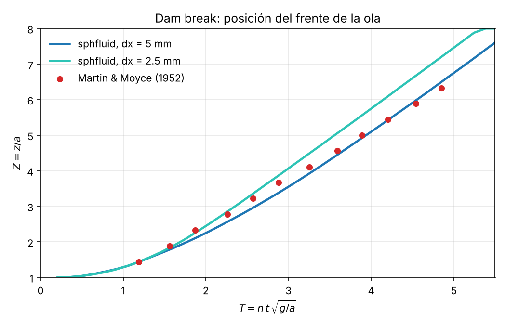

# sphfluid · Simulación de fluidos en GPU

**Rotura de una presa sobre un valle en miniatura, con 2,3 millones de partículas, simulada con Position Based Fluids en la GPU y renderizada en Blender Cycles.**


🎬 [Render completo en 4K](media/render_4k.mp4) · 📊 [Validación experimental](#validación) · ⚡ [Rendimiento](#rendimiento) · 🧱 [v1, el trabajo de clase](legacy/v1)

> *English summary:* GPU fluid simulator written from scratch in Python + [Taichi](https://www.taichi-lang.org/). Position Based Fluids solver, counting-sort neighbour grid, Akinci boundary particles plus analytic colliders, validated against the Martin & Moyce (1952) dam-break experiment. Surface reconstruction with splashsurf and rendering in Blender Cycles, all driven by one resumable pipeline.

---

## Qué hay dentro

| | |
|---|---|
| **Solver** | Position Based Fluids (Macklin & Müller, 2013): restricción de densidad incompresible, corrección de tensión artificial (*s_corr*) y viscosidad XSPH. |
| **Vecinas** | Rejilla uniforme de lado *h* construida con *counting sort* y un *prefix sum* propio que funciona en CPU y GPU. Las partículas se reordenan en memoria por celda en cada paso, así que los bucles de vecinas leen rangos contiguos. |
| **Fronteras** | Partículas de frontera de Akinci et al. (2012) con el volumen calibrado frente a una pared de referencia (densidad exacta de 1000 kg/m³ en el contacto), más colisionadores analíticos (cajas orientadas y secciones de presa en arco) como garantía dura. |
| **Escena** | Generada por código desde una semilla: terreno por *heightfield*, presa en arco con brecha, 40 casas, iglesia y puente. Las mismas mallas alimentan la simulación y el render. |
| **Render** | Superficie del agua con [splashsurf](https://github.com/InteractiveComputerGraphics/splashsurf) (*marching cubes* sobre el campo de color SPH), gotas de spray, y escena de Blender montada por script: materiales procedurales, bosque con Geometry Nodes, cámara animada que sigue el frente de la ola y profundidad de campo tipo maqueta (*tilt-shift*). |
| **Calidad** | Tipado, `ruff`, tests con `pytest` (kernels, densidad en reposo, presión hidrostática, compuertas, vecinas frente a fuerza bruta) e integración continua. |

## Validación

El caso clásico de rotura de presa 2D de **Martin & Moyce (1952)**: una columna de agua de anchura *a* y altura 2*a* se desploma sobre un canal seco. Se compara la posición del frente de la ola con los datos del artículo (Tabla 2, n² = 2), alineando el origen de tiempos en Z = 1,44 como hace el propio artículo.



| Resolución | Error medio del frente |
|---|---|
| dx = 5 mm (6.400 partículas) | 4,3 % |
| dx = 2,5 mm (51.200 partículas) | 7,4 % |

Sin parámetros ajustados para cuadrar con el experimento. A más resolución el frente avanza algo más rápido que en el canal real, como cabe esperar de un modelo sin rozamiento con el fondo.

```bash
python -m sphfluid run scenes/dam_break_validation.toml --arch cpu
python validation/martin_moyce.py output/dam_break_validation --plot validacion.png
```

## Rendimiento

Escena final en una **NVIDIA RTX 5050 Laptop**: 2,29 M partículas de agua y 5,1 M de frontera. Simular 3,2 s de riada (320 frames) lleva unos 10 minutos.

| | v1 (clase) | v2 |
|---|---|---|
| Partículas | 4.325 | 2.292.259 |
| Hardware | CPU, Python + NumPy | GPU, Taichi (CUDA) |
| Rendimiento con el mismo caso en CPU | 1× | **11,5×** |

`benchmarks/compare_v1.py` mide partículas·paso por segundo de ambas versiones con la misma carga.

## Uso

```bash
pip install -e ".[surface,plots]"

# 1. Simulación (elige GPU automáticamente si hay una)
python -m sphfluid run scenes/valley.toml

# 2. Todo el pipeline: simulación → superficie → cámara → escena de Blender → render
python tools/run_pipeline.py scenes/valley.toml --out output/valley --blender "ruta/a/blender"
```

Cada etapa se puede reanudar: los frames ya hechos se saltan y el progreso se escribe en `output/valley/status.json`. Para pruebas rápidas en CPU está `scenes/valley_preview.toml` (67.000 partículas).

## Estructura

```
sphfluid/
  solver.py        Position Based Fluids (kernels Taichi)
  grid.py          rejilla de vecinas con counting sort
  kernels.py       Poly6 / Spiky y calibraciones
  geometry.py      muestreo de fluido y fronteras, heightfields
  colliders.py     colisionadores analíticos
  scenes/          dam_break (validación) y valley (escena final)
  surface.py       reconstrucción con splashsurf + spray
  analysis.py      seguimiento del frente para la cámara
blender/           escena, carga del agua por frame y render
tools/             pipeline completo
validation/        Martin & Moyce (1952)
benchmarks/        v1 frente a v2
legacy/v1/         el proyecto original de clase (POV-Ray)
```

## De la v1 a la v2

La [v1](https://github.com/Daniijs/simulacion-fluidos-sph/tree/v1-clase) fue el proyecto final de una asignatura: SPH clásico en Python con 4.325 partículas, una caja, una esfera y render en POV-Ray. La v2 es una reescritura completa: otro método (PBF), GPU, fronteras robustas, validación experimental y un pipeline de render de producción.

## Referencias

- M. Macklin, M. Müller. *Position Based Fluids*. ACM TOG (SIGGRAPH), 2013.
- N. Akinci et al. *Versatile Rigid-Fluid Coupling for Incompressible SPH*. ACM TOG, 2012.
- M. Müller, D. Charypar, M. Gross. *Particle-Based Fluid Simulation for Interactive Applications*. SCA, 2003.
- J. C. Martin, W. J. Moyce. *An Experimental Study of the Collapse of Liquid Columns on a Rigid Horizontal Plane*. Phil. Trans. R. Soc. A 244, 1952.

---

**Autor:** Daniel Jiménez Soler · [GitHub](https://github.com/Daniijs) · Licencia MIT
