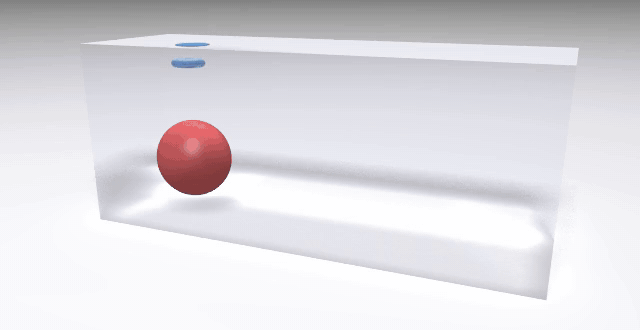

# Simulación de fluidos SPH en Python

Simulador 3D de fluidos basado en **SPH (Smoothed Particle Hydrodynamics)** escrito desde cero en Python y NumPy. Un chorro de ~4.300 partículas cae sobre una esfera, se derrama y se asienta dentro de un tanque. Cada frame se exporta a **POV-Ray** para renderizarlo con trazado de rayos y fotones, y también al formato binario de partículas de **RealFlow**.



🎬 [Vídeo completo (800×600, 30 fps)](media/simulacion_fluidos.mp4)

---

## Qué hace

- **Fuente de fluido por capas**: el "grifo" emite discos circulares de partículas con una rotación progresiva entre capas, para que la columna no quede alineada en rejilla.
- **SPH completo**: densidad con kernel *Poly6*, presión con gradiente *Spiky*, viscosidad con laplaciano viscoso y un término de cohesión sencillo que evita que las partículas se dispersen.
- **Búsqueda de vecinos con spatial hashing**: celdas de tamaño `h`; la vecindad de 27 celdas se calcula una vez por celda activa, no por partícula.
- **Colisiones vectorizadas** con las paredes del tanque (rebote + rozamiento) y con una esfera (separando la velocidad normal de la tangencial).
- **Integración de Euler** semi-implícita con sub-pasos (`dt = 0.0005 s`, 10 sub-pasos por frame).
- **Exportación**: escena `.pov` por frame (fluido como `blob` con IOR del agua, caja de cristal, fotones) y `.bin` compatible con RealFlow.

## Arquitectura

| Módulo | Responsabilidad |
|---|---|
| `Main.py` | Parámetros, bucle principal y exportación por frame |
| `SistemaParticulas.py` | Estado en arrays NumPy (posición, velocidad, fuerza, densidad, presión, masa) con capacidad ampliable |
| `Particula.py` | Objeto partícula (usado por la fuente y los exportadores) |
| `Fuente.py` | Generación de capas circulares de partículas |
| `SpatialHashing.py` | Rejilla hash para la búsqueda de vecinos |
| `Dinamica.py` | Cálculo SPH de densidad, presión y fuerzas |
| `GestorColision.py` | Colisiones con los límites del tanque y con la esfera |
| `MetodoEuler.py` | Integración temporal vectorizada |
| `ExportadorPOV.py` | Escena de POV-Ray por frame |
| `ExportadorRF.py` | Fichero binario de partículas de RealFlow por frame |
| `CrearVideo.py` | Une los PNG renderizados en un MP4 con FFmpeg |
| `render_master.pov` · `animacion.ini` | Render por lotes de la animación en POV-Ray |

```
Fuente ──► SistemaParticulas ──► SpatialHashing ──► Dinamica (SPH)
                                                       │
                     ExportadorPOV / ExportadorRF ◄── MetodoEuler ◄── GestorColision
```

## Parámetros principales

| Parámetro | Valor |
|---|---|
| Partículas | 4.325 (25 capas × 173) |
| Radio de suavizado `h` | 0,06 m |
| Densidad en reposo | 1000 kg/m³ |
| Constante de presión `k` | 5000 |
| Viscosidad | 0,4 |
| Paso de tiempo | 0,0005 s × 10 sub-pasos por frame |
| Tanque | 4,4 × 1,8 × 1,4 m |

## Cómo ejecutarlo

Requisitos: Python 3.10+, [POV-Ray 3.7](http://www.povray.org/) y [FFmpeg](https://ffmpeg.org/).

```bash
pip install -r requirements.txt

# 1. Simular y exportar los frames (.pov en POV_Frames/ y .bin en RF_Frames/)
python Main.py

# 2. Renderizar la animación con POV-Ray
povray animacion.ini

# 3. Montar el vídeo
python CrearVideo.py
```

> La simulación y el render son costosos: cuenta con varias horas para la animación completa. Para una prueba rápida, baja `Final_Frame` en `animacion.ini` y el número de frames en `Main.py`.

Las carpetas `POV_Frames/` y `RF_Frames/` se generan al ejecutar y no se incluyen en el repositorio (ocupan más de 500 MB).

## Tecnologías

Python · NumPy · VPython (tipo `vector`) · POV-Ray · FFmpeg · RealFlow (formato de exportación)

---

**Autor:** Daniel Jiménez Soler · [GitHub](https://github.com/Daniijs)
